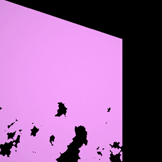
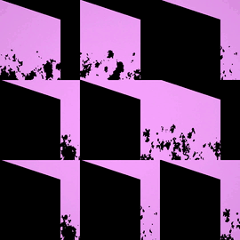
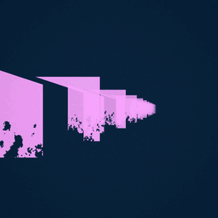
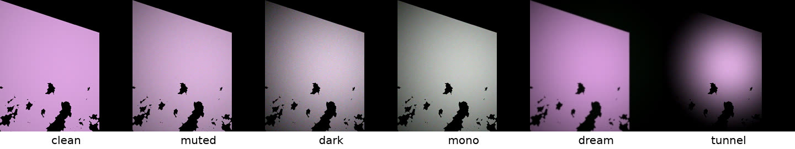
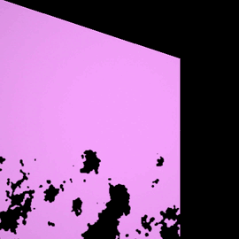

# nltl-animate

Turn a track and a few still images into a square music video: the images breathe, pulse, switch and travel in time with the beat.

<table>
  <tr>
    <td></td>
    <td></td>
    <td></td>
  </tr>
  <tr>
    <td align="center"><code>single</code></td>
    <td align="center"><code>grid</code></td>
    <td align="center"><code>train</code></td>
  </tr>
</table>

Every clip combines three separate choices:

- a **layout**: how the images are arranged (`single`, `grid` or `train`, above);
- a **grade**: how the picture looks (contrast, color, softness, vignette, grain);
- a **motion**: how it moves with the beat (breath, shake, pulse, shade).

The output is always a 1080×1080 MP4.

## Install

You need [ffmpeg](https://ffmpeg.org) (with ffprobe) on your PATH. Version 5.1 or newer is needed for the `grid` layout. Then:

```bash
go install github.com/nothinglefttolearn/nltl-animate/cmd/nltl-animate@latest
```

This needs [Go](https://go.dev) 1.27.4 or newer. To build from a clone instead, see [Development](#development).

## Getting started

### Your first clip

Pass an audio file and an image:

```bash
nltl-animate track.wav cover.jpg
```

You get a clip as long as the track, with the image gently breathing and pulsing. It is saved next to the audio file under a name like `nltl_animate_single_audio_20261117-215301.mp4`, so renders never overwrite each other. Use `-o` to save it somewhere else.

A full render takes a while, so add `--preview` to render the first 10 seconds at low quality first:

```bash
nltl-animate --preview track.wav cover.jpg
```

### Keep time with the music

The movement lands on the beat: without `--bpm`, the tool detects the track's tempo and prints the BPM it found. Pass the tempo yourself to skip detection or override it:

```bash
nltl-animate track.wav cover.jpg                 # detects the tempo
nltl-animate --bpm 138 track.wav cover.jpg
```

### Choose a look

The default is the `muted` grade (pulled-back color, grain, a vignette) with the `steady` motion (slow breathing in time). Pick others by name:

```bash
nltl-animate --grade dark --motion restless --bpm 138 track.wav cover.jpg
nltl-animate --grade clean --motion still track.wav photo.jpg   # a photo that shouldn't move
```

`nltl-animate grades` and `nltl-animate motions` list every option and what it does.



### Use several images

With several images, the clip jumps to a different one on every beat:

```bash
nltl-animate --bpm 138 track.wav frames/*.png
nltl-animate --bpm 138 --hold-beats 4 track.wav frames/*.png     # every 4 beats instead
```



### Try another layout

```bash
nltl-animate grid --n 3 --tiles mixed --bpm 138 track.wav frames/*.png   # a different image per tile
nltl-animate train --bpm 138 track.wav logo.png                          # one copy passes per beat
```

The train works best with a PNG with transparency, such as a logo or a cut-out.

### Make a silent loop

`--no-audio` drops the track: every argument is an image, and the clip loops seamlessly when played on repeat. The examples on this page were made this way.

```bash
nltl-animate --no-audio cover.jpg                    # a 3 second loop
nltl-animate --no-audio --bpm 120 frames/*.png       # each image once, one per beat
```

### Or let it ask

Run `nltl-animate` with no arguments, in a folder with your audio and images, and a form asks for everything. It can render a preview, open it, and let you adjust the grade and motion before the full render. Afterwards it prints the equivalent command so you can run it again.

## Learn more

- [The guide](docs/guide.md) covers each layout, every grade and motion, custom grades and motions in a config file, silent loops, tempo detection and output files.
- `nltl-animate --help` and `nltl-animate <layout> --help` list every flag.
- [CONTEXT.md](CONTEXT.md) defines the terms used throughout.

## Development

```bash
git clone https://github.com/nothinglefttolearn/nltl-animate
cd nltl-animate
mise install        # pinned Go and linters (or use your own Go 1.27.4+)
mise run build      # builds ./nltl-animate
mise run ci         # every check CI runs
```

See [AGENTS.md](AGENTS.md) for the architecture and the other tasks. The example images on this page are rendered by `mise run docs:examples` from the images in `docs/examples/images`.
